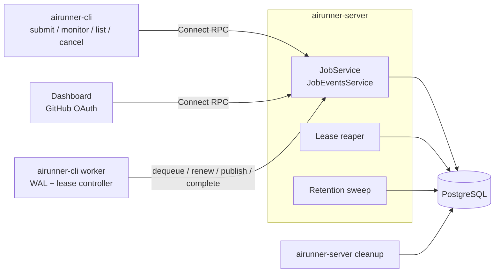

# airunner

airunner runs commands on remote workers and streams their output back in order. Clients enqueue jobs through a [Connect RPC](https://connectrpc.com/) server, workers dequeue and execute them using [console-stream](https://github.com/wolfeidau/console-stream), and PostgreSQL stores job state and the event log. Delivery is at-least-once with bounded attempts, every job belongs to an organization, and a job completes only after its whole log is committed.

## Prerequisites

- Go 1.26.0 or later (see `go.mod`)
- make
- [bun](https://bun.sh) (frontend dependencies; esbuild runs inside the Go build)
- Docker (PostgreSQL via `docker-compose.yml`, and testcontainers for integration tests)
- [mkcert](https://github.com/FiloSottile/mkcert)
- [goreman](https://github.com/mattn/goreman) and [direnv](https://direnv.net/)

## Quick start

1. Generate local TLS certificates (writes `.certs/cert.pem` and `.certs/key.pem`):

```sh
brew install mkcert
make certs
```

2. Create `.envrc` with these variables, then run `direnv allow`:

| Variable | Purpose |
|---|---|
| `AIRUNNER_TLS_CERT`, `AIRUNNER_TLS_KEY` | Server TLS certificate and key |
| `COMPOSE_POSTGRES_PASSWORD` | Password for the compose PostgreSQL container |
| `POSTGRES_CONNECTION_STRING` | Server connection string for that database |
| `AIRUNNER_POSTGRES_TOKEN_SECRET` | HMAC secret for task tokens |
| `AIRUNNER_GITHUB_CLIENT_ID`, `AIRUNNER_GITHUB_CLIENT_SECRET`, `AIRUNNER_GITHUB_CALLBACK_URL` | GitHub OAuth for dashboard login |

3. Start PostgreSQL:

```sh
docker compose up -d postgres
```

4. Start the server and a worker. `Procfile.dev` runs the server with `--no-auth` and `--postgres-auto-migrate`:

```sh
direnv exec . goreman -f Procfile.dev start
```

5. In another shell, submit, monitor, list and cancel jobs:

```sh
go run ./cmd/cli submit --config configs/example-job.yaml --monitor "https://github.com/wolfeidau/airunner"
go run ./cmd/cli list --watch
go run ./cmd/cli monitor <job-id>
go run ./cmd/cli cancel <job-id>
```

The server listens on `0.0.0.0:443` by default. Open the dashboard at `https://localhost`. It lists jobs, shows job events and has a Cancel button.

## Authentication

- **Development**: `--no-auth` disables authentication and seeds a dev organization and principal with admin, user and worker roles. `Procfile.dev` uses it.
- **CLI and workers**: JWTs signed by a local credential.
  1. `airunner-cli init <name> --set-default` creates a key pair under `~/.airunner/credentials/`.
  2. Import the public key in the dashboard Credentials view (GitHub login).
  3. `airunner-cli credentials update --org-id=<id> --principal-id=<id> <name>` records the server-assigned IDs.
- **Dashboard**: GitHub OAuth sessions.
- **Authorization**: user and admin roles may enqueue, list, stream and cancel. Worker and admin roles may dequeue, update, complete and publish events. Callers are derived from authentication only, and unknown procedures are denied.

## Architecture



Job flow:

1. `submit` enqueues a job in `SCHEDULED` state for an organization and queue.
2. A worker dequeues it with `SKIP LOCKED`. The job becomes `RUNNING`, consumes one attempt (`max_attempts` defaults to 3), and gets a task token and a lease (visibility timeout, 30-3600s, default 300s).
3. The worker runs the command, writes events to a per-attempt WAL at `~/.airunner/wal/<job-id>/<attempt>.wal`, and publishes them with `PublishJobEvents` (up to 50 events and 1 MiB per call). The server acknowledges after commit.
4. The worker renews the lease about every timeout/3 and stops at its local lease deadline if it cannot.
5. On exit the worker completes the job. The server accepts completion only when `final_event_sequence` equals the last committed sequence. The job becomes `COMPLETED` or `FAILED`.
6. The reaper (every 5s by default) returns expired leases to `SCHEDULED`, or to `FAILED` when attempts are exhausted.
7. `cancel` moves a job to `CANCELLED`. A connected worker notices at its next publish or renewal and stops.

`monitor` streams events by polling (500ms by default), pinned to one attempt (`--attempt`, 0 selects the latest). The stream ends when the attempt closes.

## Guarantees

- At-least-once delivery with bounded attempts.
- No writes through a stale lease. Every token operation is fenced under a row lock.
- Committed events survive worker loss.
- Unacknowledged WAL records are lost if the lease is lost or the worker disk is lost.
- A job completes only after its whole log is committed.
- Cancellation stops a connected worker at its next publish (about 2s while it produces output) or renewal (about 1.25 x timeout/3 + 5s RPC), plus 5s grace. A partitioned worker stops at its local lease deadline.

Design and phase specs: [specs/job-lifecycle/README.md](specs/job-lifecycle/README.md) and [00-architecture.md](specs/job-lifecycle/00-architecture.md).

## Operations

- **Retention**: terminal jobs are kept 90 days (`--job-retention-days`) and their events 30 days (`--events-retention-days`; 0 keeps events until the job is deleted). The server sweeps every hour (`--retention-interval`). Set it to 0 to disable in-process sweeps and run `airunner-server cleanup` on a schedule instead.
- **Metrics and tracing**: pass `--tracing` to `airunner-server server`, `airunner-server cleanup` and `airunner-cli worker`. Export is configured through the standard `OTEL_EXPORTER_OTLP_*` environment variables.
- **Failed WALs**: `airunner-cli worker --keep-failed-wal=<duration>` keeps discarded WALs for inspection. The default (0) deletes them.
- **Runbook**: [specs/job-lifecycle/operations-runbook.md](specs/job-lifecycle/operations-runbook.md).

## Demo: program status (OSC 7501)

Programs can report what they are doing (working, blocked, done, error) by writing [OSC 7501](https://www.superlogical.com/rex/docs/build/program-status) escape sequences to their output. The worker parses these reports for every job and publishes each one as a `PROGRAM_STATUS` job event, ordered against the surrounding output. The worker only records reports; it takes no action on `blocked`.

`airunner-cli test-status` emits a scripted sequence of reports, interleaved with plain output, so you can see this end to end.

| `--scenario` | Reports | Exit code |
|---|---|---|
| `happy` (default) | `build/compile` and `build/test` working 0→100% then done, then `build` done | 0 |
| `blocked` | as `happy`, plus `build/deploy` blocked on a question, auto-approved after `--step-delay` | 0 |
| `fail` | `build/test` working, then error `2 tests failed` | 1 |

`--steps` (default 5) sets progress updates per id and `--step-delay` (default 500ms) sets the pause between them.

With the server and a worker running, build the CLI and submit a job that runs it:

```sh
make build-cli
go run ./cmd/cli submit --monitor \
  --command "$PWD/bin/airunner-cli" --args="test-status,--scenario=blocked" \
  github.com/example/demo
```

- The worker runs the command on its host, so `--command` must be an absolute path the worker can execute.
- Pass `--args` as a single `--args="…"` token; the comma-separated values contain flags, which the CLI otherwise rejects.
- Add `--credential NAME` if your default credential is not registered with the server (`go run ./cmd/cli credentials list` shows the default).
- Add `--process-type=pipe` to run without a PTY; both modes capture reports.

What to expect:

- `monitor` prints a `📟 Program status:` line per report, e.g. `blocked [build/deploy/question] - Approve deploy?`.
- The dashboard shows each report as its own line: blocked in orange, done in green, error in red. Raw escape sequences are stripped from the output.
- `--scenario=fail` ends the job as `FAILED` with exit code 1.

## Development

```sh
make build                       # Build airunner-cli and airunner-server into ./bin
make test                        # Unit tests with coverage
make test-integration            # All tests including integration (testcontainers, Docker required)
make test-integration-postgres   # PostgreSQL store integration tests only
make lint                        # Run the linter
make proto-generate              # Regenerate Go code from api/*.proto
```

Integration tests start isolated PostgreSQL containers on dynamic ports and clean them up. Run `make help` for all targets. Contributor and agent guidance is in [AGENT.md](AGENT.md).

## License

Apache License, Version 2.0 - Copyright [Mark Wolfe](https://www.wolfe.id.au)
