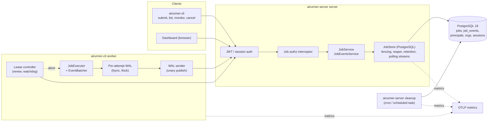
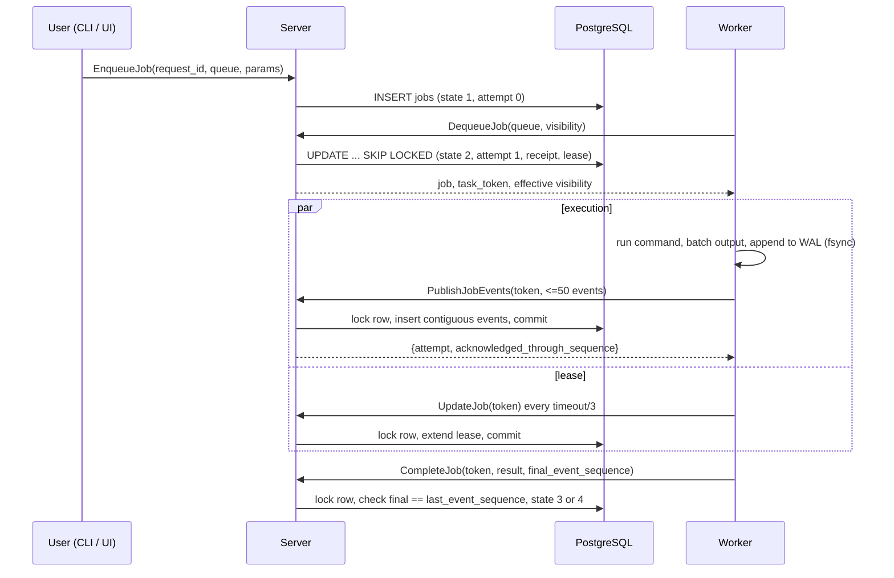
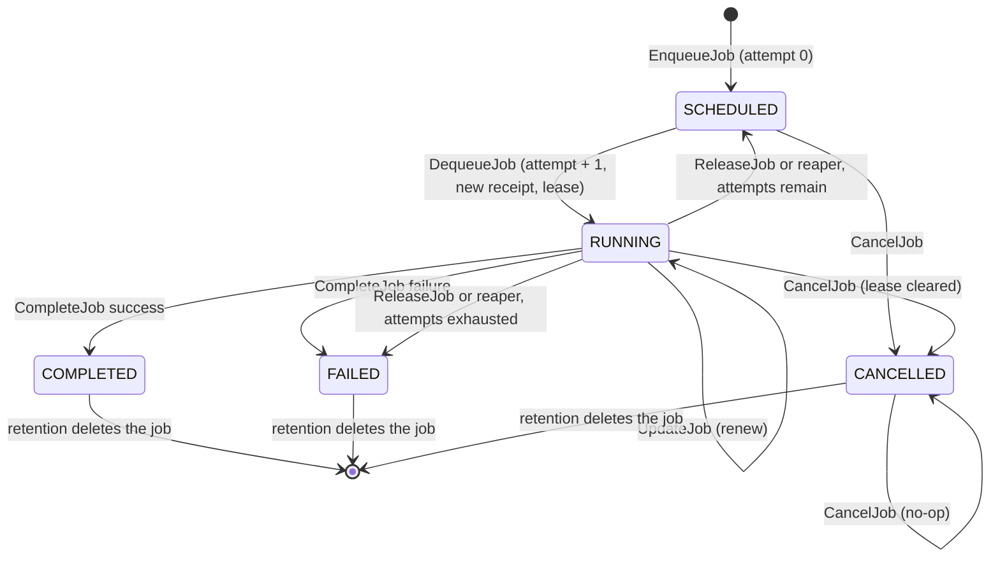

# Architecture: Job Lifecycle and Tenancy

[← README](README.md) | [Phase 1 →](01-phase1-worker-events.md) | [Runbook](operations-runbook.md)

This document describes the system **as built**. It is verified against the code, not copied from the [redesign plan](../job-lifecycle-tenancy-redesign-plan.md). Where the plan and the code differ, the code is documented here and the difference is listed in [Differences from the plan](#differences-from-the-plan). Phase files hold the detail for each change; this file holds the whole picture.

## Contents

- [Summary and goals](#summary-and-goals)
- [Components](#components)
- [Data model](#data-model)
- [State machine](#state-machine)
- [Leases and fencing](#leases-and-fencing)
- [Publish contract and completion gate](#publish-contract-and-completion-gate)
- [Worker, WAL and sender](#worker-wal-and-sender)
- [Tenancy, roles and errors](#tenancy-roles-and-errors)
- [Event streams](#event-streams)
- [Retention](#retention)
- [Cancellation](#cancellation)
- [Metrics](#metrics)
- [Reference model and differential replay](#reference-model-and-differential-replay)
- [Verification limits](#verification-limits)
- [Configuration reference](#configuration-reference)
- [Key decisions](#key-decisions)
- [Differences from the plan](#differences-from-the-plan)

## Summary and goals

airunner runs commands on remote workers and streams their output back in order. The job lifecycle has to survive worker crashes, network partitions and retries without losing output, running a stale worker's writes, or crossing a tenant boundary.

**Goals**

1. Deliver each job at least once, with at most `max_attempts` lease acquisitions.
2. Let only the current lease holder mutate a job or its event log.
3. Acknowledge an event only after it is committed, and complete a job only when the server holds its whole log.
4. Keep each attempt's log, WAL and stream separate.
5. Scope every read and write to the caller's organization.
6. Bound retention, sweeps and every database lock wait.
7. Make failure visible through bounded-label metrics.

**Non-goals**

- Exactly-once execution. A finished command can run again if its final flush fails after the process exits.
- Zero event loss across a worker crash and lease expiry. Unacknowledged local records are lost by design.
- Protection from external side effects. Fencing guards the job store only.
- A second job backend, a message broker, or LISTEN/NOTIFY.

## Components



| Component | Location | Responsibility |
|---|---|---|
| `JobStore` interface | [internal/store/job_store.go](../../internal/store/job_store.go) | The contract: every caller-facing method takes `store.Caller` and is org-scoped |
| PostgreSQL store | [internal/store/postgres/job_store.go](../../internal/store/postgres/job_store.go) | Enqueue, dequeue, fenced token operations, cancel, reaper, publish, polling streams |
| Retention | [internal/store/postgres/job_store_retention.go](../../internal/store/postgres/job_store_retention.go) | `PurgeEvents`, `PurgeJobs`, `SweepRetention` |
| Session sweeper | [internal/store/postgres/session_sweeper.go](../../internal/store/postgres/session_sweeper.go) | Bounded expired-session deletes |
| Authz | [internal/auth/authz.go](../../internal/auth/authz.go) | Role table and interceptor for the job services |
| Handlers and error map | [internal/server/](../../internal/server/) | `JobServer`, `JobEventServer`, `toConnectError`, stream write deadline |
| Executor and batcher | [internal/worker/](../../internal/worker/) | Runs the command through console-stream and batches output |
| WAL and sender | [internal/worker/wal/](../../internal/worker/wal/) | Durable local log, acknowledgement-validating sender, stale cleanup |
| Lease controller | [internal/worker/lease/controller.go](../../internal/worker/lease/controller.go) | Renewal, local deadline, watchdog |
| Worker command | [cmd/cli/internal/commands/worker.go](../../cmd/cli/internal/commands/worker.go) | Wires the pieces and settles each job |
| Server commands | [cmd/server/internal/commands/](../../cmd/server/internal/commands/) | `server`, `cleanup`, retention flags |
| Reference model | [internal/store/storetest/](../../internal/store/storetest/) | Pure-Go oracle for the contract |
| Metrics | [internal/telemetry/](../../internal/telemetry/) | Server and worker instruments |

**Happy path for one job**



## Data model

Schema source: [1_initial_schema.sql](../../internal/store/postgres/migrations/1_initial_schema.sql) and [2_principal_org_fks.sql](../../internal/store/postgres/migrations/2_principal_org_fks.sql). Excerpts with commentary are in [examples/schema.md](examples/schema.md). The migration runner ([migrations.go](../../internal/store/postgres/migrations.go)) applies numbered files once each and records them in `schema_migrations`.

### `jobs`

| Column | Type | Notes |
|---|---|---|
| `job_id` | UUID PK | UUIDv7 |
| `org_id` | UUID NOT NULL | FK `organizations`, `ON DELETE CASCADE` |
| `created_by` | UUID NOT NULL | Composite FK `(created_by, org_id)` to `principals(principal_id, org_id)` |
| `leased_by` | UUID | Composite FK `(leased_by, org_id)`; set only while RUNNING |
| `queue` | VARCHAR(255) NOT NULL | Queues are `(org_id, queue)` |
| `state` | INTEGER NOT NULL | 1 SCHEDULED, 2 RUNNING, 3 COMPLETED, 4 FAILED, 5 CANCELLED. No default |
| `request_id` | VARCHAR(255) NOT NULL | Client-supplied idempotency key |
| `request_fingerprint` | BYTEA NOT NULL | SHA-256 of the enqueue intent |
| `attempt` | INT NOT NULL DEFAULT 0 | Lease acquisitions so far |
| `max_attempts` | INT NOT NULL | 1 to 100 |
| `last_event_sequence` | BIGINT NOT NULL DEFAULT 0 | Highest covered sequence of the current attempt |
| `created_at`, `updated_at` | TIMESTAMPTZ NOT NULL | `updated_at` is set on every transition; retention measures from it |
| `visibility_until` | TIMESTAMPTZ | Lease expiry; set only while RUNNING |
| `receipt_handle` | UUID | New on every acquisition; set only while RUNNING |
| `job_params` | JSONB NOT NULL | |
| `execution_config` | JSONB | Server default applied at enqueue |
| `result` | JSONB | Cleared on each acquisition. Set on completion, or `{"reason": "delivery attempts exhausted"}` |

| Constraint | Rule |
|---|---|
| `jobs_org_request_id_key` | `UNIQUE (org_id, request_id)` |
| `jobs_attempt_bounds` | `0 <= attempt <= max_attempts` |
| `jobs_max_attempts_bounds` | `1 <= max_attempts <= 100` |
| `jobs_last_event_sequence_check` | `last_event_sequence >= 0` |
| `jobs_state_check` | `state BETWEEN 1 AND 5` |
| `jobs_lease_consistency` | RUNNING requires `visibility_until`, `receipt_handle`, `leased_by` and `attempt > 0`; every other state requires all three NULL |
| `jobs_created_by_org_fkey`, `jobs_leased_by_org_fkey` | Creator and leaser must belong to the job's org. `leased_by` is MATCH SIMPLE, so NULL passes |

**Fingerprint.** `enqueueFingerprint` ([fingerprint.go](../../internal/store/postgres/fingerprint.go)) hashes the length-prefixed queue, the deterministic `job_params` encoding, and the requested `max_attempts` or an "omitted" marker. `execution_config` is excluded because the server supplies it. An omitted `max_attempts` stays "omitted" on retry even if the server default later changes.

### `job_events`

| Column | Type | Notes |
|---|---|---|
| `job_id` | UUID NOT NULL | FK `jobs`, `ON DELETE CASCADE` |
| `attempt` | INT NOT NULL | `> 0`. Stamped from the locked job row |
| `sequence` | BIGINT NOT NULL | `> 0`. First sequence the record covers |
| `end_sequence` | BIGINT NOT NULL | `>= sequence`. An output batch covers `[sequence, end_sequence]` |
| `timestamp` | TIMESTAMPTZ NOT NULL | Worker clock; never used for retention |
| `event_type` | INTEGER NOT NULL | `EventType` enum |
| `event_payload` | BYTEA NOT NULL | Deterministic protobuf of the whole `JobEvent` |

Primary key `(job_id, attempt, sequence)`. There is no `ttl` column and no `org_id`; the parent job carries tenancy and age. Events are retained by the parent job's age. The table is not partitioned.

### Indexes

| Index | Definition | Used by |
|---|---|---|
| `idx_jobs_dequeue` | `(org_id, queue, created_at, job_id) WHERE state = 1` | `DequeueJobs` |
| `idx_jobs_lease` | `(visibility_until, job_id) WHERE state = 2` | `ReapExpired`, reaper backlog |
| `idx_jobs_list` | `(org_id, queue, state, created_at, job_id)` | `ListJobs` |
| `idx_jobs_retention` | `(updated_at, job_id) WHERE state IN (3, 4, 5)` | `PurgeEvents`, `PurgeJobs`, retention lag |
| `idx_job_events_timestamp` | `(job_id, attempt, timestamp)` | `from_timestamp` streams |
| `idx_job_events_type` | `(job_id, attempt, event_type)` | Type filtering |

Every lifecycle query writes the state as a literal (`state = 1`, `state IN (3, 4, 5)`). A bound `state = $1` loses the partial index once PostgreSQL picks a generic plan; see [decision 4](#key-decisions).

### Other tables

`organizations`, `principals` (type `user`, `worker` or `service`; roles array; `UNIQUE (principal_id, org_id)`) and `sessions` carry identity. `--no-auth` seeds a reserved org and user principal (`00000000-0000-7000-8000-000000000001` and `...0002`, roles `admin`, `user`, `worker`) in one idempotent transaction, and fails startup if a conflicting reserved row exists ([dev_identity.go](../../internal/store/postgres/dev_identity.go)). Authenticated startup never seeds.

## State machine



| Transition | Trigger | Rule |
|---|---|---|
| Enqueue | `EnqueueJob` | Inserts state 1, attempt 0. `ON CONFLICT (org_id, request_id) DO NOTHING`; an existing row with the same fingerprint returns the same job, a different fingerprint is `ErrConflict` |
| Acquire | `DequeueJobs` | `state = 1 AND attempt < max_attempts`, oldest first, `FOR UPDATE SKIP LOCKED`. Sets state 2, `attempt + 1`, `last_event_sequence = 0`, `result = NULL`, `leased_by`, `visibility_until = NOW() + timeout`, a new `receipt_handle` |
| Renew | `UpdateJobVisibility` | Fenced. `visibility_until = operation_time + timeout` |
| Complete | `CompleteJob` | Fenced. `final_event_sequence` must equal `last_event_sequence`. State 3 on success, 4 on failure. Clears the lease |
| Release | `ReleaseJob` | Fenced. State 1 if `attempt < max_attempts`, otherwise state 4 with the exhausted reason. Clears the lease |
| Expire | Reaper | Same rule as release, for `state = 2 AND visibility_until <= clock_timestamp()` |
| Cancel | `CancelJob` | States 1 and 2 become 5 and clear the lease. State 5 is a no-op. States 3 and 4 return `ErrFailedPrecondition` |

Rules that hold on every path:

- Every acquisition consumes an attempt, even if the response is never delivered. Attempts and receipts are never decremented or reused.
- Release, the reaper and dequeue all apply the same bound, independently.
- All non-RUNNING transitions clear `visibility_until`, `receipt_handle` and `leased_by` together, to satisfy `jobs_lease_consistency`.
- Terminal states never reopen. Explicit command failure is terminal and is not retried.
- If the server cannot deliver a dequeued job, it releases that job and every unsent job in the batch, each under `WithTimeout(WithoutCancel(ctx), 5s)`. Delivery failures spend attempts.
- Every transition sets `updated_at`.

## Leases and fencing

A **task token** is `base64url(v1|job_id|queue|receipt_handle|hmac_sha256_hex)` ([task_token.go](../../internal/store/postgres/task_token.go)). It carries no org, attempt or worker identity: those come from the locked database row and the authenticated caller. The HMAC is checked in constant time; a bad token is `ErrInvalidTaskToken` and never reaches the database. Raw tokens are never logged.

### Fence algorithm

`UpdateJobVisibility`, `CompleteJob`, `ReleaseJob` and `PublishEvents` all call `lockLease` ([job_store.go](../../internal/store/postgres/job_store.go); excerpt in [examples/fenced-publish.md](examples/fenced-publish.md)):

1. Decode and verify the token.
2. Begin a READ COMMITTED transaction and run `SET LOCAL lock_timeout = '5s'; SET LOCAL statement_timeout = '5s'`.
3. `SELECT ... FROM jobs WHERE org_id = $caller AND job_id = $token FOR UPDATE`. A missing row is `ErrLeaseLost`.
4. If the row is CANCELLED, return `ErrJobCancelled` (which wraps `ErrLeaseLost`).
5. Sample `clock_timestamp()` once, **after** the lock is held, as `operation_time`.
6. Require state RUNNING, matching receipt and queue, `leased_by = caller`, and `visibility_until > operation_time`. **Equality is expired.** Any failure is `ErrLeaseLost` with a generic message.
7. Perform the whole mutation in the same transaction. Return success only after commit.

`now()` is frozen at transaction start. A transaction that waited for a lock would validate against a time before the wait. `clock_timestamp()` avoids that; see [decision 3](#key-decisions).

### Acceptance point

A publish accepted under a valid lease may commit after the lease's wall-clock expiry while it holds the row lock. Cancellation, release and reclamation serialize on the same row and cannot commit ahead of it. An operation that reaches the lock after expiry fails. This is a stated rule, not a claim that every commit precedes expiry. Barrier tests cover both orderings.

### Lock bound

Each store operation is bounded by 10s (`QueryTimeoutSeconds`, or the caller's earlier deadline). Inside a fenced transaction, lock waits and statements are bounded by 5s. A lock-wait or statement timeout, a serialization failure, a deadlock, a lost connection, a database shutdown or a resource limit maps to `ErrUnavailable` (Connect Unavailable), which callers may retry.

### Reaper

`ReapExpired(ctx, limit)` ([excerpt](examples/bounded-sweeps.md#reaper-reapexpired)) claims `state = 2 AND visibility_until <= clock_timestamp()` rows ordered by `(visibility_until, job_id)` with `FOR UPDATE SKIP LOCKED`, applies the release rule and clears the lease. The loop sweeps immediately at Start and then every `--lease-reaper-interval` (5s) under the store's lifecycle context. Each tick runs up to 10 batches of 100 rows and stops on a short batch. A row locked by an in-flight publish is skipped and reclaimed on the next tick. Replicas can reap concurrently. After each tick the reaper records `reaper.sweep_duration`, `reaper.backlog` and `reaper.oldest_expired_age`.

Five seconds is a polling interval. It is not a guaranteed redelivery bound under overload or database failure.

## Publish contract and completion gate

`PublishJobEvents` is unary. The server returns `{attempt, acknowledged_through_sequence}` only after the fenced transaction commits.

### Limits

Checked in the handler, before any store access ([job_event.go](../../internal/server/job_event.go)):

| Limit | Value | Result |
|---|---|---|
| Events per request | 50 | ResourceExhausted |
| Encoded request size | 1 MiB (`1 << 20`) | ResourceExhausted |
| One event's payload | 350 KiB | `ErrEventTooLarge`, ResourceExhausted |

### Rules

| Case | Result |
|---|---|
| Record starts at `last_event_sequence + 1` | Inserted. `last` becomes its end |
| Record identical to a stored row (same start, same end, same deterministic payload bytes) | No-op, acknowledged again |
| Same start, different end or payload | `ErrConflict`, AlreadyExists |
| Start at or below `last` with no stored row at that start | `ErrInvalidArgument` (overlap) |
| Start above `last + 1` | `ErrInvalidArgument` (gap) |
| Output batch where `sequence != start_sequence`, or `len(outputs) != end - start + 1` | `ErrInvalidArgument` |
| Missing timestamp, non-positive sequence, `event.attempt` 0 or not equal to the leased attempt | `ErrInvalidArgument` |

A rejection rolls back the whole request. The server stamps the attempt from the locked row, and the response carries the highest covered sequence of the request, including output-batch ends. A replayed batch counts as `events.publish_replays` and inserts nothing. An empty request returns a zero result.

A server commit and the worker learning about it are separate events. A lost response changes the worker's knowledge, not the committed log. An identical retry receives the same acknowledgement, and fence validation still runs, so an expired lease never regains write authority.

### Completion gate

`CompleteJobRequest.final_event_sequence` must equal the attempt's `last_event_sequence`, checked under the fence. A mismatch is `ErrInvalidArgument` and leaves the job RUNNING. Zero is valid only when no events were published.

## Worker, WAL and sender

[worker.go](../../cmd/cli/internal/commands/worker.go) runs one job at a time. Phase detail: [04b-phase4b-worker-durability.md](04b-phase4b-worker-durability.md).

### Execution and recording

The executor ([internal/worker/worker.go](../../internal/worker/worker.go)) drains the console-stream iterator through `consumeEvents` until it finishes, so events after `ProcessEnd` (for example `CONTAINER_REMOVE`) are recorded. `ProcessError` is published and treated as a failure, joined with the exit error. A stream without `ProcessEnd` is a failure. Output over 200 KiB is split into chunks. Flush, buffering and batcher `Stop` errors are returned, never logged and dropped, because a swallowed error here means lost events. The `EventBatcher` keeps the first timer-flush error and returns it from later calls. Detail: [01-phase1-worker-events.md](01-phase1-worker-events.md).

### WAL identity and ownership

| Rule | Behaviour |
|---|---|
| Path | `<wal-dir>/<job-id>/<attempt>.wal`. The default `wal-dir` is `~/.airunner/wal`; there is no flag |
| Header | 36 bytes: magic `ARWAL001` (8), version 2 (4), job UUID (16), attempt (4), reserved (4). A header that does not match its path is rejected |
| Records | Length, sequence, status, timestamp, protobuf payload and a CRC64-NVME checksum. `Append` stamps `event.attempt` and fsyncs before returning |
| Ownership | Exclusive non-blocking `flock` for the file's lifetime. A second opener gets `ErrWALLocked` |
| Stale file, same attempt | Truncated and rewritten under the lock; its records are never replayed |
| Sequence space | A new dequeue always creates a new WAL starting at sequence 1. Another attempt's records never enter a new token's sender |
| No token on disk | The WAL holds no bearer token. The token lives in memory only |

**Startup cleanup (`CleanupStale`).** At worker start it deletes legacy flat `<job>.wal` files, and for each `<job>/<attempt>.wal` it can lock, it logs job, attempt and pending count, then deletes the file or moves it to `<wal-dir>/failed/<job>-<attempt>.wal` when `--keep-failed-wal` is set. Files locked by a live process are skipped. `failed/` is pruned by age (all files when the flag is 0). Records are never uploaded under a new lease, and the old command is never restarted. The logged pending count is an upper bound: sent status is held in memory, so a crashed WAL looks fully pending.

**Discard.** `Discard(keep)` cancels any in-flight send, then deletes the file, or moves it to `failed/` when `keep` is set.

**Archive.** After a confirmed completion the worker stops the WAL and archives it to `~/.airunner/archive/<job>-<attempt>.wal.zst` (zstd). Nothing prunes the archive; see [Known gaps](README.md#known-gaps).

**Loss boundary.** Committed events survive worker loss. Events never acknowledged are lost when the lease expires or the worker disk is lost. Recovering them would need a separate authorized, attempt-scoped upload API, which is out of scope. This replaces the tokenless orphan upload proposed in [wal-execution-isolation.md](../wal-execution-isolation.md).

### Sender

- One batch at a time, in sequence order. A batch holds at most **50 records** and **900 KiB** of encoded events (headroom under the server's 1 MiB). A record is never split. A lone record over the byte budget is sent alone.
- `Send` returns `Ack{Attempt, Through}`. The batch is marked sent only if `Attempt` equals the WAL's attempt and `Through` equals the batch's last covered sequence. Anything else is `ErrAckMismatch`, which is permanent.
- An unreadable or corrupt pending record is a permanent failure. Later records are never sent past it.
- The error is sticky. `Flush` returns it immediately instead of waiting.

| Connect code | WAL class | Sender behaviour |
|---|---|---|
| FailedPrecondition | `ErrLeaseLost` | Stop, sticky |
| InvalidArgument, AlreadyExists, ResourceExhausted | `ErrPermanent` | Stop, sticky |
| Unavailable, DeadlineExceeded, network errors, other codes | transient | Retry with exponential backoff from 1s, doubling, capped at 60s, with +/-20% jitter |

### Lease controller

[controller.go](../../internal/worker/lease/controller.go) renews the lease and enforces a local execution budget.

- **Cadence.** Renew immediately, then every `accepted / 3` with +/-25% jitter. `accepted` is the effective timeout from the last response. The worker starts executing at once; it does not wait for the first renewal.
- **Local deadline.** `sent + accepted - max(2s, accepted/10)`, where `sent` is the monotonic time taken **before** the request. Before any renewal succeeds, the deadline is `start + accepted - margin`.
- **RPC bound.** Each renewal times out at `min(5s, remaining budget)`. Transient failures retry with backoff from 500ms capped at 5s.
- **Abort.** FailedPrecondition aborts at once (`ErrLost`, or `ErrCancelled` with the lease-reason header). An independent watchdog aborts at the confirmed deadline even while an RPC is blocked. A response that arrives after the previous confirmed deadline cannot revive the budget. Nothing reverses an abort.
- **Effect.** Abort cancels the execution context. console-stream sends SIGTERM to the process group, then SIGKILL after 5s; containers stop with a 2s grace.
- **Clocks.** Budgets use monotonic elapsed time. Database timestamps are for diagnostics.

### Completion decision table

`jobRun.finish` settles each job after execution returns.

| Condition after execution | Action |
|---|---|
| Controller aborted, or the sender reports lease lost | No complete, no release. Discard the WAL. The reaper redelivers (or the job is already cancelled) |
| Flush returns `ErrPermanent` | `CompleteJob` FAILED with `final_event_sequence = Acked()` and a message that the log is incomplete, then discard the WAL |
| Flush times out after `min(30s, Remaining())` with records pending | Stop renewal, do not complete, discard the WAL. Expiry redelivers, deliberately re-running a finished command rather than completing with an incomplete log |
| All records acknowledged | `CompleteJob` with `final_event_sequence = Acked()`, then archive the WAL |
| `CompleteJob` returns FailedPrecondition | Treat as lease lost (cancelled if the header says so) |
| `CompleteJob` fails for another reason | Discard the WAL (kept in `failed/` only with `--keep-failed-wal`). The worker never re-executes because of it |

A worker that has lost its lease never completes or releases the job. Cancelled jobs are logged as "job cancelled".

## Tenancy, roles and errors

### Caller identity

Handlers derive `store.Caller{OrgID, PrincipalID}` from `auth.PrincipalFromContext`; a missing principal is Unauthenticated. The caller never comes from a request field. Every query, mutation, request-ID lookup and stream is scoped by `org_id`.

### Role matrix

Enforced by [authz.go](../../internal/auth/authz.go) before any handler or store access ([examples/authz-interceptor.md](examples/authz-interceptor.md)). The interceptor wraps unary and streaming handlers and runs after the logging and OpenTelemetry interceptors, so denials are logged and traced.

| RPC | user | worker | admin |
|---|---|---|---|
| `EnqueueJob`, `ListJobs`, `CancelJob`, `StreamJobEvents` | yes | | yes |
| `DequeueJob`, `UpdateJob`, `CompleteJob`, `PublishJobEvents` | | yes | yes |

Precedence: no principal is Unauthenticated; a principal without an allowed role is PermissionDenied; an unknown procedure under `/job.v1.JobService/` or `/job.v1.JobEventsService/` is PermissionDenied (fails closed). A coverage test fails when an RPC is added without a role entry. `CredentialService` keeps its own inline admin checks.

Admin is scoped to its org. An admin in org A gets NotFound for org B's job, and does not bypass lease ownership: a token operation still requires `leased_by = caller`. Processes that share one principal are one authorization identity; use separate worker credentials for worker-to-worker isolation. Login users receive `admin,user`; imported worker credentials receive `worker`.

### Org-boundary behaviour

| Operation | Another org's job |
|---|---|
| Direct-ID stream or cancel | `ErrJobNotFound`, NotFound, same as an absent job |
| `ListJobs` | An empty page; only the caller's org is queried |
| `DequeueJob` | No jobs from other orgs are visible; it continues its normal poll |
| Token operations | `ErrLeaseLost`, FailedPrecondition, same as any other lease failure |
| Create or lease | Composite foreign keys reject a creator or leaser from another org |

### Error map

One mapper, `toConnectError` ([errors.go](../../internal/server/errors.go)), serves every job and event handler.

| Store error | Connect code |
|---|---|
| existing `*connect.Error` | passthrough |
| `ErrInvalidTaskToken`, `ErrInvalidArgument`, `ErrJobIDMismatch`, `ErrQueueMismatch` | InvalidArgument |
| `ErrEventTooLarge` | ResourceExhausted |
| `ErrJobNotFound` | NotFound |
| `ErrJobCancelled` | FailedPrecondition, with response metadata `Airunner-Lease-Reason: cancelled` |
| `ErrLeaseLost`, `ErrFailedPrecondition` | FailedPrecondition |
| `ErrConflict` | AlreadyExists |
| `context.DeadlineExceeded`, `context.Canceled` | DeadlineExceeded, Canceled |
| `ErrUnavailable` | Unavailable |
| anything else | Internal with the generic message `internal error`; the cause is logged server-side |

`ErrJobCancelled` is tested before `ErrLeaseLost` because it wraps it. The header lives in [internal/leasereason](../../internal/leasereason/) so the CLI can import it without server dependencies; no proto change was needed. A malformed or foreign task token is InvalidArgument; a correctly signed token that no longer holds a lease is FailedPrecondition, and the response never says which check failed.

### Visibility timeout

Validated at the RPC boundary only: 0 means 300s, otherwise 30 to 3600s, else InvalidArgument. The store accepts any positive value so tests can use short leases. The effective value is returned in `DequeueJobResponse` and `UpdateJobResponse`, and workers use it rather than their local default.

## Event streams

`StreamJobEvents` serves replay and tail from the persisted log by polling. Detail: [04c-phase4c-event-streams.md](04c-phase4c-event-streams.md).

### Attempt resolution

| Request `attempt` | Behaviour |
|---|---|
| 0 | Resolves once to `max(1, jobs.attempt)`. It pins the latest started attempt, or waits for attempt 1, and does not follow later retries |
| `1 .. max(1, jobs.attempt)` | Streams exactly that attempt |
| Greater than that, or negative | InvalidArgument |
| Absent job, other org, malformed ID | NotFound |

### Closed rule

For resolved attempt `a`, with the job's observed `attempt` and `state`:

```text
closed = jobs.attempt >  a                                  -- a later attempt exists
      || (jobs.attempt == a && state != RUNNING)            -- finished, released, reaped or cancelled
      || (jobs.attempt <  a && state is terminal)           -- cancelled or failed before it started
```

Fencing rejects publishes to an attempt that is no longer RUNNING, so once the server observes `closed`, the attempt's event set is final. `ProcessEnd` is never the termination signal.

### Producer loop

1. Resolve the attempt and send a status-only response (`resolved_attempt`, `job_state`, `attempt_closed`).
2. Start the cursor at `max(from_sequence, 1)`. `from_sequence` is inclusive.
3. Repeat: observe the job **before** reading events; read up to 100 rows with `attempt = a AND end_sequence >= cursor`, ordered by sequence, optionally filtered by `from_timestamp` (milliseconds); advance the cursor to `end_sequence + 1` for every scanned row, including rows removed by `event_filter`; send matching events.
4. A full page reads the next page immediately. A short page after a `closed` observation sends the final status and ends the stream. Otherwise wait `--event-poll-interval` (500ms).

| Property | Behaviour |
|---|---|
| Output-batch cursor | `end_sequence >= cursor` returns the whole batch that covers `from_sequence`. Resume at the last delivered covered end + 1 |
| Decode failure | Ends the stream with an error; the row is never skipped |
| Backpressure | The handler sends synchronously. A slow reader slows only its own stream; nothing is buffered or dropped, and no connection is held between pages |
| Stall deadline | A single send blocked for `--stream-send-timeout` (30s) ends the stream with DeadlineExceeded and increments `streams.stalled`. Clients reconnect from their last sequence. 0 disables it |
| Replicas | All delivery comes from the database, so any replica serves any stream |
| Purged events | Status only. Missing records are never fabricated |
| Deleted job | NotFound |
| Shutdown | The stream ends with Unavailable |
| Latency | Up to one poll interval behind the commit |

The deadline works through middleware on `/job.v1.JobEventsService/` that exposes `http.ResponseController.SetWriteDeadline`. Clearing the deadline after each send also lifts the HTTP server's 5 minute `WriteTimeout` for event streams, so a monitor on a long job is not cut off. If the writer does not support deadlines, the server logs once at Debug and streams without one.

### Clients

`monitor --attempt N` selects an attempt (default 0), prints `Attempt N, state X` when status changes, exits when the server closes the stream, and reports an attempt that closed without `PROCESS_END`. `submit --monitor` streams attempt 0. The dashboard shows the resolved attempt, offers a selector when more than one attempt exists, and keys events by `job_id-attempt-sequence`.

## Retention

Detail: [05a-phase5a-retention.md](05a-phase5a-retention.md). SQL: [examples/bounded-sweeps.md](examples/bounded-sweeps.md).

| Rule | Behaviour |
|---|---|
| Eligible | `state IN (3, 4, 5)` only. SCHEDULED and RUNNING jobs are never deleted by retention |
| Age | `jobs.updated_at` against `clock_timestamp()`, read once per pass. Never the event's client timestamp |
| Event cutoff | `now - events-retention`. When events retention is 0, the job cutoff applies, so events live as long as their job |
| Job cutoff | `now - job-retention`. A job is deleted only after its events are gone; `ON DELETE CASCADE` is a safety net |
| Order | Events, then jobs, then sessions |
| Lock order | `PurgeEvents` locks up to 100 job rows (`FOR UPDATE SKIP LOCKED`) before deleting their events, matching publish |
| Bounds | 1,000 rows per statement. In-process: 10 statements per category per pass. `cleanup`: `--max-batches` (100). A short batch ends the category |
| Replicas | `SKIP LOCKED` prevents double deletes and double counts |
| Failure | Logged and counted with `category=clock\|events\|jobs`; the category is skipped until the next pass |
| Sessions | `expires_at < clock_timestamp()`, oldest first, 1,000 per statement, 10 statements per pass |

**Ordering and bounds.** At the default of 10 statements per category, one in-process pass deletes at most 10,000 events and 10,000 jobs. Larger backlogs drain over several passes. `idx_jobs_retention` finds eligible jobs.

**In-process or scheduled.** The server sweeps at Start and then every `--retention-interval` (1h). With `--retention-interval=0` the server runs no retention or session sweeps, and `airunner-server cleanup` runs one pass and exits. Both use the same code (`JobStore.SweepRetention`, `SweepExpiredSessions`), so they can overlap safely. `cleanup` never runs migrations and never starts the reaper; it exits non-zero if any category fails, and exits 0 with a warning if backlog remains. The reaper always runs in the server, because redelivery depends on its 5s cadence.

**Idempotency window.** Request IDs are unique per org only while the job exists. After the job is deleted, the same request ID creates a new job, so idempotency lasts for job retention.

**Eventual deletion.** Deletion depends on the sweep schedule, the backlog and database availability. Track `retention.oldest_eligible_age` rather than asserting that expired rows never exist.

## Cancellation

Detail: [06-phase6-cancellation.md](06-phase6-cancellation.md).

`CancelJob` takes the job row lock with the same 5s bound as every fenced operation. SCHEDULED and RUNNING become CANCELLED and clear the lease. `attempt` and `last_event_sequence` are unchanged, so the cancelled attempt's log stays readable until retention removes it. A publish that holds the lock first commits and its events stay in the log; a publish that locks after the cancel gets `ErrJobCancelled` and persists nothing. There is no interleaving in between.

| Aspect | Behaviour |
|---|---|
| Signal | `lockLeaseRow` returns `ErrJobCancelled`; the server sets `Airunner-Lease-Reason: cancelled` on the FailedPrecondition |
| Detection | The next renewal maps the header to `lease.ErrCancelled`. The controller aborts and cancels the execution context. A publish or complete that sees the header is treated the same way |
| Shutdown | SIGTERM to the process group, SIGKILL after 5s; containers stop with a 2s grace. No complete, no release. The WAL is discarded |
| Connected bound | Detection takes at most the maximum jittered renewal interval plus one bounded RPC: about `1.25 x timeout/3 + 5s`. Shutdown adds up to 5s. 135s worst case at the 300s default, 22.5s at 30s |
| Partitioned | The worker cannot see the cancel. Its local lease deadline stops it, and the server already fences every write |
| Interfaces | `JobService.CancelJob` (user, admin), `airunner-cli cancel <job-id>` (exit 0 for an already-cancelled job, 1 for a finished or missing job), a dashboard Cancel button |

Cancel stops future work. It cannot undo effects already produced.

## Metrics

Instruments are built once with `telemetry.NewMetrics(meter)` and injected; there is no global. Attributes are bounded enums only (`result`, `operation`, `reason`, `category`, `procedure`, `from`); metrics never carry job IDs, tokens, org IDs or queue names. Full tables, alert starting points and worker instruments: [05b-phase5b-metrics.md](05b-phase5b-metrics.md). Scenario-based use: [operations-runbook.md](operations-runbook.md#metrics-reference).

| Area | Instruments |
|---|---|
| Lifecycle | `jobs.enqueued`, `jobs.dequeued`, `jobs.released`, `jobs.completed{result}`, `jobs.redelivered`, `jobs.dead_lettered`, `jobs.cancelled{from}`, `jobs.lease_lost{operation}`, `lease.renewals` |
| Reaper | `reaper.sweep_duration`, `reaper.backlog`, `reaper.oldest_expired_age` |
| Retention | `retention.sweep_duration`, `retention.oldest_eligible_age`, `retention.{events,jobs,sessions}_deleted`, `retention.sweep_errors{category}` |
| Events | `events.published`, `events.publish_duration`, `events.publish_replays`, `events.publish_rejected{reason}` |
| Streams | `streams.active`, `streams.delivery_lag`, `streams.stalled` |
| Authz | `authz.denied{procedure, reason}` |
| Worker (`worker --tracing`) | `worker.wal.pending_records`, `worker.wal.failed_deleted`, `worker.publish.ack_latency`, `worker.publish.retries`, `worker.lease.aborts{reason}`, `worker.jobs.abandoned{reason}` |

`--tracing` (env `AIRUNNER_TRACING`) enables export on `airunner-server server`, `airunner-server cleanup` and `airunner-cli worker`, using the standard `OTEL_EXPORTER_OTLP_*` variables. `streams.delivery_lag` is `now - event.timestamp`, and the worker sets the timestamp, so worker clock skew biases it.

## Reference model and differential replay

[internal/store/storetest](../../internal/store/storetest/) is a pure-Go oracle. It has no PostgreSQL, Connect, filesystem, goroutine or wall-clock dependency, and it reuses no production transition helpers. Identities and time are explicit inputs. Commands, invariants and run commands: [examples/reference-model.md](examples/reference-model.md).

**Modelled:** Enqueue (retry, conflict, cross-org), Acquire (FIFO, attempt bound), Renew, Release, Complete (with the final sequence), Publish (contiguity, replay, conflict, ranges), Expire, Cancel, List. State per job: org and creator, queue, request ID and fingerprint, lifecycle state, attempt and max attempts, lease principal, receipt and deadline, terminal reason, and the committed record prefix per attempt.

**Invariants checked after every command**, including rejected ones: terminal states never reopen; attempts are monotonic, bounded, and equal to the acquisition count; lease fields are set exactly when RUNNING; records in an attempt are contiguous from 1; `last_event_sequence` equals the covered prefix; a rejected command leaves the snapshot unchanged.

**Tests:** hand-written boundary histories, `TestPropertyGeneratedHistories` (500 seeds of 200 commands), and `FuzzJobContract` for longer exploration (not a phase gate).

**Differential replay.** `TestDifferentialReplay` replays seeded `storetest.Generate` histories against a PostgreSQL testcontainer (200 histories of 60 commands by default; `-replay.histories`, `-replay.length`). After every step it compares the outcome kind and the normalized job view. All command kinds are enabled, including stale-receipt, wrong-holder, wrong-org, unknown-job and at-deadline token operations.

- **Time scale.** One model unit is 3 real seconds, so a live lease is at least 3s from expiry and stays valid for one store call even under `-race`. Before each command the adapter rewrites every RUNNING job's `visibility_until` to `clock_timestamp() + (modelDeadline - modelNow) * 3s`. A zero offset is therefore already expired, matching the model's equality rule. `Expire` maps to that rewrite followed by `ReapExpired`.
- **Adapter.** It maps handles to real IDs and tokens, turns model records into output-batch events with deterministic payloads and timestamps so identical retries are byte-identical, and never computes expected results.
- **Regression.** A failing seed is printed with a reproduction command; add it to `regressionSeeds`.
- **Disagreements.** When the model and PostgreSQL disagree, review the written contract. Neither is automatically correct.

**Excluded:** the task token HMAC and signing secret, the 5s lock and statement timeouts, wall-clock races (the adapter controls time through SQL), the 50-event and 1 MiB limits, the 350 KiB event limit, retention and sweeps, streams, role checks, and WAL and worker behaviour. Those are covered by targeted integration, sender and controller tests.

## Verification limits

Passing finite tests is evidence, not proof.

| Layer | Proves | Does not prove |
|---|---|---|
| Model tests | The written contract is internally consistent for the generated command space | That the implementation matches it |
| Differential replay | The store agrees with the model on 200 default histories of 60 commands, step by step | Behaviour outside generated histories, concurrency, or timing the adapter does not model |
| Barrier tests | Both orderings of publish against cancel, complete, release and reaping | Every interleaving; they pin the acceptance-point rule at known races |
| Sender and controller fake-receiver tests | Pending records advance only on a valid acknowledgement; an abort is never reversed; late responses cannot revive the budget | fsync durability, kernel locking, real network behaviour |
| Filesystem and process tests | WAL header, `flock`, stale cleanup, deletion on lease loss | Power loss or disk failure |
| Authz matrix | Every procedure and role, fail-closed behaviour, org boundary | Misconfigured upstream authentication |

Other limits to keep in mind:

- Redelivery and cleanup are **progress** properties. They need time to advance, storage to be available, the reaper and sweeps to run, and a worker or sweeper to get CPU. Tests exercise these assumptions explicitly; nothing here claims progress under permanent partition, process suspension or storage failure.
- Safety (no stale-owner write) is separate from progress. Fencing protects store mutations after a suspended process resumes. It cannot stop external effects, and it cannot make a suspended process stop on time.
- Small test fixtures can legitimately choose sequential scans. Check `EXPLAIN` plans after `ANALYZE`, including generic plans, on realistic data before claiming capacity; benchmark dequeue and poll latency first.
- Container start-up never goes inside the fuzz target.

Test patterns to copy: [examples/contract-test-skeleton.md](examples/contract-test-skeleton.md).

## Configuration reference

All flags verified against `--help`. Server flags are on `airunner-server server`; the retention flags are shared with `airunner-server cleanup`.

| Flag | Env | Default | Notes |
|---|---|---|---|
| `--lease-reaper-interval` | `AIRUNNER_LEASE_REAPER_INTERVAL` | 5s | Must be positive |
| `--postgres-default-max-attempts` | `AIRUNNER_DEFAULT_MAX_ATTEMPTS` | 3 | 1 to 100 |
| `--postgres-token-signing-secret` | `AIRUNNER_POSTGRES_TOKEN_SECRET` | none | At least 32 bytes. Required, including by `cleanup` |
| `--postgres-conn-string` | `POSTGRES_CONNECTION_STRING` | none | Required |
| `--postgres-auto-migrate` | `AIRUNNER_POSTGRES_AUTO_MIGRATE` | false | `server` only in effect |
| `--job-retention-days` | `AIRUNNER_JOB_RETENTION_DAYS` | 90 | Must be positive |
| `--events-retention-days` | `AIRUNNER_EVENTS_RETENTION_DAYS` | 30 | 0 keeps events until the job is deleted; must not exceed job retention |
| `--retention-interval` | `AIRUNNER_RETENTION_INTERVAL` | 1h | 0 disables in-process retention and session sweeps |
| `--event-poll-interval` | `AIRUNNER_EVENT_POLL_INTERVAL` | 500ms | Must be positive |
| `--stream-send-timeout` | `AIRUNNER_STREAM_SEND_TIMEOUT` | 30s | 0 disables |
| `--no-auth` | `AIRUNNER_NO_AUTH` | false | Development only; seeds the dev identity |
| `--tracing` | `AIRUNNER_TRACING` | false | Metrics and trace export |
| `cleanup --max-batches` | `AIRUNNER_CLEANUP_MAX_BATCHES` | 100 | Batches per category per run |
| `worker --visibility-timeout` | none | 300 | 30 to 3600 seconds |
| `worker --keep-failed-wal` | `AIRUNNER_KEEP_FAILED_WAL` | 0 | Duration; 0 disables |
| `monitor --attempt` | none | 0 | 0 selects the latest attempt |

Fixed constants: reaper 10 batches of 100 rows; fenced lock and statement timeout 5s; store query timeout 10s; store stop timeout 10s; stream page 100 rows; publish limits 50 events and 1 MiB; sender batch 50 records and 900 KiB; final flush `min(30s, remaining budget)`; renewal RPC `min(5s, remaining budget)`.

## Key decisions

Each decision lists the alternatives rejected and the evidence. External sources were accessed 2026-10-18; numeric limits, polling and failure policies are project choices that the verification above exercises.

| # | Decision | Alternatives considered | Why |
|---|---|---|---|
| 1 | **PostgreSQL is the only job backend.** Jobs reference orgs and principals by foreign key | Keep the memory store for development; keep an AWS store | Foreign keys and row locks are the fencing mechanism. A second backend would need its own implementation of every rule and its own oracle checks. The memory and AWS job stores were removed; Compose gives a local PostgreSQL |
| 2 | **At-least-once with at most `max_attempts` acquisitions.** Every acquisition counts, even an undelivered one. Explicit failure is terminal | Exactly-once; unbounded retries; refund attempts on delivery failure | Exactly-once needs cooperation from the command. A refund rule needs a second state machine. Counting every acquisition gives one bound enforced identically at release, expiry and dequeue. Queue guidance: [SQS visibility timeout](https://docs.aws.amazon.com/AWSSimpleQueueService/latest/SQSDeveloperGuide/sqs-visibility-timeout.html); SQS defaults and limits do not apply |
| 3 | **Row-lock fencing with a post-lock `clock_timestamp()`.** Equality is expired. Publication accepted under a valid lease may commit after expiry while holding the lock | `now()` comparison in one `UPDATE`; a version column with compare-and-swap; advisory locks; a lease epoch checked in the application | Experiment 2 (PostgreSQL 18): a session waited 3s for a row lock, then `now()` still equalled the transaction start while `clock_timestamp()` had advanced 2.46s. `now()` would accept a lease that expired during the wait. Taking the row lock also serializes cancel, release, completion, dequeue and reaping against publish on one row, with no new lock type. [Row locks](https://www.postgresql.org/docs/current/explicit-locking.html), [time functions](https://www.postgresql.org/docs/current/functions-datetime.html) |
| 4 | **Literal state predicates in lifecycle SQL** | Bound `state = $1` parameters | Experiment 1 (100,000 rows, 1% SCHEDULED): with a bound parameter and `force_generic_plan`, PostgreSQL used a bitmap scan and a 50,000-row sort; with a literal it used the partial index with no sort. PostgreSQL may switch to a generic plan after five executions, so a bound state loses the partial index in steady state. [Partial indexes](https://www.postgresql.org/docs/current/indexes-partial.html), [SELECT locking](https://www.postgresql.org/docs/current/sql-select.html) |
| 5 | **Unary `PublishJobEvents` returning a commit acknowledgement** | Keep client streaming; a bidirectional acknowledgement protocol | A client-streaming RPC has one final response after the request stream closes; individual sends are not application commit acknowledgements. Unary batches cost request overhead but give each bounded batch one acknowledgement and remove stream ownership and reconnection from the worker. A bidirectional protocol is deferred until measurements justify it. [Connect streaming](https://connectrpc.com/docs/go/streaming/) |
| 6 | **Content-compared idempotent append** keyed by `(job, attempt, sequence)`, with a changed payload as a conflict | `INSERT ... ON CONFLICT DO NOTHING`; dedupe on key alone | `DO NOTHING` would silently accept a different record under an existing key. Comparing the deterministic payload turns a rewritten WAL record into an explicit `ErrConflict`. Idempotent requests need stable caller intent and atomic recording of the identity with its effects: [AWS Builders' Library](https://aws.amazon.com/builders-library/making-retries-safe-with-idempotent-APIs/), [INSERT](https://www.postgresql.org/docs/current/sql-insert.html) |
| 7 | **Completion gate: `final_event_sequence` must equal `last_event_sequence`** | Trust that the worker flushed; complete and reconcile later | The gate makes "complete" mean "the server holds the whole log". The cost is that a transient final-flush failure re-runs a finished command, by design |
| 8 | **Per-attempt WAL, deleted on lease loss**, with an optional `--keep-failed-wal` window | Job-ID-only WAL (the original); tokenless orphan upload ([wal-execution-isolation.md](../wal-execution-isolation.md)); quarantine directory | Job-ID keys mixed attempts. A tokenless upload is a bypass of fencing. Quarantine adds a recovery path nobody runs. Deleting keeps the safety property simple: a stale attempt's records never reach a new lease |
| 9 | **Database polling for streams** (500ms, 100 rows per page) | In-process fanout; LISTEN/NOTIFY; a broker | Fanout is per process, so a reader on another replica saw nothing and slow readers lost events. Polling the persisted log is correct on any replica and needs no notification recovery protocol. Cost: query load and up to one interval of latency. Measure active streams, query rate and tail lag before changing |
| 10 | **Conservative local lease deadline from the pre-request monotonic time, plus an independent watchdog** | Trust the renewal response time; first-failure abort | A response can arrive late. Taking the clock before sending, and refusing to revive a budget after its deadline, makes a delayed response safe. [Go monotonic clocks](https://pkg.go.dev/time#hdr-Monotonic_Clocks), [`context.WithoutCancel`](https://pkg.go.dev/context#WithoutCancel). Margins and abort policy are project defaults validated by failure tests |
| 11 | **Retention by job age; no per-event TTL** | Per-event TTL column; time partitioning | Events of a finished job are removed as a unit, so replay and retry deduplication never see a partial log. Only terminal jobs qualify, so no live writer needs deleted rows. Partitioning adds operational surface with no current benefit |
| 12 | **In-process sweeps plus a separate `cleanup` command** | In-process only; external only | One code path, two schedules. Small deployments need no scheduler; larger ones can run cleanup on its own schedule, logs and exit status. The reaper stays in the server because redelivery needs its cadence |
| 13 | **Cancellation as a row transition signalled by a response header** | A new status field in the proto; polling a job-state RPC | `ErrJobCancelled` wraps `ErrLeaseLost`, so existing lease-loss handling applies. The `Airunner-Lease-Reason` header distinguishes cancel without a protocol change |
| 14 | **Org-scoped admin; roles by RPC** | Global admin; role checks inside handlers | An admin can reach every procedure for the org but no other org's data. One interceptor with a coverage test cannot be forgotten by a new handler |
| 15 | **Pure-Go reference model plus differential replay as the contract oracle** | Example-based tests only; formal proof tooling; a generic workflow framework | The highest-risk rules cross the store, worker, WAL and RPC boundaries. An executable model states them once. The model stays independent of production SQL, so agreement is meaningful. [Go fuzzing](https://go.dev/doc/security/fuzz/) covers longer exploration. Formal proof tooling and a framework were out of scope |
| 16 | **Bounded metric labels** | Per-job, per-queue or per-org labels | Unbounded labels grow cardinality without limit. Per-job detail belongs in logs and traces |
| 17 | **Greenfield schema, no backfill, no protocol compatibility** | Compatibility migration; dual-protocol server | The project is undeployed. Compatibility code would outlive its purpose |

Out of scope by design: a generic workflow framework, mandatory formal proof tooling, a second job backend and a broad package reorganization.

## Differences from the plan

The code is documented above. These are the places where it differs from the [redesign plan](../job-lifecycle-tenancy-redesign-plan.md).

| Topic | Plan | As built |
|---|---|---|
| Default attempts flag | `--default-max-attempts` | `--postgres-default-max-attempts` (env `AIRUNNER_DEFAULT_MAX_ATTEMPTS`) |
| Token secret flag | not named | `--postgres-token-signing-secret`. The startup error text says `--postgres-token-secret`, which is not a flag |
| WAL metric | "WAL pending bytes" | `worker.wal.pending_records` (a count of records) |
| First renewal | "On dequeue, immediately renew before executing" | The controller renews immediately but concurrently; execution does not wait for the first renewal. The initial budget is `start + accepted - margin` |
| Lease loss seen by the sender | The sender's lease-loss error enters the worker abort path | The sender stops publishing at once, but execution is aborted only by the controller on its next renewal (or the watchdog). A [known gap](README.md#known-gaps) with a planned fix |
| Lost `CompleteJob` response | "Keep the file as diagnostic data under the same pruning rule" | The WAL is discarded, and kept in `failed/` only when `--keep-failed-wal` is set |
| Archive pruning | Archives are pruned | `wal.CleanupArchive` exists but nothing calls it |
| Cancelled job and token checks | Cancel is an ordinary lease loss | A CANCELLED row returns `ErrJobCancelled` before receipt, queue and principal checks, so any token for that job learns "cancelled" (still scoped to the caller's org) |
| Stream stall | "DeadlineExceeded after 30s without send progress" | A per-send write deadline through `http.ResponseController`; it also lifts the 5 minute `WriteTimeout` for event streams |
| Unmapped store errors | Internal | `ErrUnavailable` maps to Unavailable; only unknown errors map to Internal |
| Session sweep bounds | Not specified | 1,000 rows per statement, 10 statements per pass in-process; `cleanup` uses `--max-batches` |
| Retention default | "30 days" for events | 30 days applies only when both retention values are unset in the store config; the server flags always set both explicitly (defaults 90 and 30) |
| `cleanup` flags | Not specified | Accepts the server's `--postgres-*` flags including `--postgres-auto-migrate`, which it ignores |

[← README](README.md) | [Phase 1 →](01-phase1-worker-events.md) | [Runbook](operations-runbook.md)
