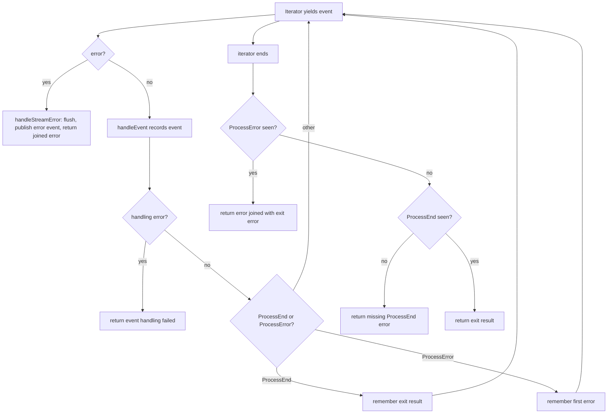

# Phase 1: Worker events

[← README](README.md) | [Phase 2 →](02-phase2-schema-contract.md)

**Goal:** the worker records every event its command produces, including events that follow `ProcessEnd`, and a failure to record an event fails the job instead of disappearing.

**Status:** done, merged in PR #152 (`fix/worker-event-lifecycle`). This file is a **retrospective**: phase 1 shipped before the layered spec existed, so it is written from the commits and the code as they stand.

**Depends on:** nothing. Later phases build on the executor behaviour described here.

| Commit | Change |
|---|---|
| `433b7d7` | Added the redesign plan after a repository audit |
| `7eb8480` | Simplified the plan (PostgreSQL only, reference-model oracle, WAL deletion instead of quarantine) |
| `86874fc` | Added skipped repro tests for six defects and recorded two validated PostgreSQL assumptions |
| `bbdba39` | Fixed the executor and batcher defects below; removed the phase 1 repro skips |
| `29a8ad9` | Fixed JWK EC key parsing, which was failing lint on `main` |

Use `git show <sha>` for the full diff of any commit.

## Customer problem

The audit found that a job could finish "successfully" with its log silently incomplete, and a failed job could look like a success.

| Defect | Effect |
|---|---|
| The executor returned at `ProcessEnd`. Two near-identical loops (direct and container) stopped reading the iterator there | Events emitted afterwards were never recorded. A container job lost its `CONTAINER_REMOVE` event |
| `handleEvent` had no case for `ProcessError` | Container wait and log-stream failures produced no `PROCESS_ERROR` event and did not fail the job |
| A stream that ended without `ProcessEnd` was treated as success | A truncated run looked complete |
| Output larger than 200 KiB tripped the batcher's single-output guard | The chunk was dropped with a logged error |
| Flush, output-buffering and batcher `Stop` errors were logged and ignored | These writes go to the WAL. A swallowed error meant lost events and a job reported complete |
| `EventBatcher` timer flushes ran on a background goroutine and dropped their errors | A failed timed flush was invisible |
| A data race in `TestEventBatcherTimer` | Flaky `-race` runs |
| `parseJWK` built `ecdsa.PublicKey` from raw X and Y values (deprecated, staticcheck SA1019) | `main` failed lint after the toolchain moved to Go 1.27 in #151. Off-curve points were also accepted |

The remaining audit findings were outside the executor and were deliberately left to later phases: the CLI worker closed its publish stream before flushing the WAL, continued after final-response errors, and only logged heartbeat errors ([phase 4b](04b-phase4b-worker-durability.md)); the WAL was keyed by job ID alone ([phase 4b](04b-phase4b-worker-durability.md)); jobs had no organization boundary ([phase 2](02-phase2-schema-contract.md)).

## Success criteria

- [x] The executor drains the event iterator to completion, so events after `ProcessEnd` are recorded.
- [x] `PROCESS_ERROR` events are published, and a `ProcessError` fails the job, joined with the exit error when one exists.
- [x] A stream with no `ProcessEnd` is a failure.
- [x] Output over 200 KiB is split into chunks, never dropped.
- [x] Flush, output-buffering and batcher `Stop` errors are returned to the caller.
- [x] `EventBatcher` keeps the first timer-flush error and returns it from later calls and from `Stop`.
- [x] `TestHandleEventProcessError` and `TestContainerEventsRemoveAfterProcessEnd` pass with their skips removed.
- [x] `parseJWK` rejects points that are not on P-256 and oversized coordinates, and left-pads short coordinates.
- [x] `go test -race`, `make test` and `make lint` pass.

## What changed

### `internal/worker/worker.go`

[worker.go](../../internal/worker/worker.go) replaces the duplicated direct and container loops with one `consumeEvents`.

| Behaviour | Detail |
|---|---|
| Drain | Reads the iterator until it ends. `ProcessEnd` records the exit result (`processEndError`) and the loop keeps reading |
| `ProcessError` | Dispatched through `handleEvent` as a recorded `PROCESS_ERROR` event. The first one is kept. At the end it is returned as `message: cause`, joined with the exit error |
| Missing `ProcessEnd` | Returns `process ended without a ProcessEnd event` |
| Iterator error | `handleStreamError` flushes buffered output, publishes an error event, and returns a joined error. It stops consumption immediately, even after `ProcessEnd` |
| Event handling error | Logged and returned as `event handling failed: ...` |
| Output chunking | `addOutputChunks` splits data into pieces of at most `maxSingleOutputBytes` (200 KiB) before it reaches the batcher |
| Flush before `ProcessEnd` | Buffered output is flushed first so order is preserved |

### `internal/worker/event_batcher.go`

[event_batcher.go](../../internal/worker/event_batcher.go) stores the first timer-flush error in a sticky field. Later `AddOutput` and `Flush` calls return it, and `Stop` returns `errors.Join(stickyErr, flushErr)`. `Stop` is idempotent. The race in `TestEventBatcherTimer` is fixed.

### `internal/auth/public_key_cache.go`

[public_key_cache.go](../../internal/auth/public_key_cache.go) parses JWK EC keys with `ecdsa.ParseUncompressedPublicKey`. The parser now rejects off-curve points and oversized coordinates, and left-pads short coordinates. This change is unrelated to the lifecycle but was required to get `main` green before the redesign could land.

### What did not change

The transport. The worker still published through a client stream and marked WAL records sent on transport success. Phase 4 replaced both ([4a](04a-phase4a-fencing.md), [4b](04b-phase4b-worker-durability.md)).

## The repro-test approach

Phase 1 set the method that every later phase follows. Commit `86874fc` added one test per known defect, before any fix:

1. Write a test that asserts the **correct** behaviour.
2. Run it on current code and confirm it fails **for the stated reason**.
3. Add `t.Skip("known bug: ...")` so `main` stays green.
4. The phase that owns the fix removes the skip as part of the fix.

| Test | Defect | Observed failure | Owning phase |
|---|---|---|---|
| [`TestHandleEventProcessError`](../../internal/worker/process_error_test.go) | `ProcessError` dropped by `handleEvent` | No `PROCESS_ERROR` event published | 1 |
| [`TestContainerEventsRemoveAfterProcessEnd`](../../internal/worker/container_events_integration_test.go) (integration, needs Docker) | Executor returns on `ProcessEnd` | No `CONTAINER_REMOVE` event published | 1 |
| `TestRepro_DequeueIndexPredicateMatchesScheduledState` | Partial index on `state = 0` | `idx_jobs_dequeue ... WHERE (state = 0)` | [2](02-phase2-schema-contract.md) |
| `TestRepro_JobHandlersEnforceRoles` | No role checks on job RPCs | `user` dequeue long-polled; `worker` enqueue succeeded | [3](03-phase3-tenancy-authz.md) |
| `TestRepro_ExpiredLeaseIsRedelivered` | No lease reclamation | Job never redelivered within 15s | [4a](04a-phase4a-fencing.md) |
| `TestRepro_StaleTokenCannotPublishEvents` | Publish not fenced | Publish after completion succeeded | [4a](04a-phase4a-fencing.md) |

The same commit recorded the two PostgreSQL experiments that justify the fencing and index rules (see [decisions 3 and 4](00-architecture.md#key-decisions)). A skipped test such as the old `TestVisibilityTimeoutExpiry` is how missing redelivery went unnoticed; the repro approach replaces it with a fast, deterministic test that is un-skipped by the fix.

Beyond the repro tests, phase 1 added [consume_events_test.go](../../internal/worker/consume_events_test.go), which drives `consumeEvents` with scripted iterators:

| Test | Asserts |
|---|---|
| `TestConsumeEventsContinuesAfterProcessEnd` | `PROCESS_START`, `PROCESS_END`, `CONTAINER_REMOVE` are recorded in order |
| `TestConsumeEventsExitErrorStillPublishesContainerRemove` | A non-zero exit still records later cleanup events and returns the exit error |
| `TestConsumeEventsProcessErrorThenProcessEnd`, `...JoinsExitError`, `...WithoutProcessEnd` | `ProcessError` fails the job in each ordering |
| `TestConsumeEventsNoProcessEnd` | A stream without `ProcessEnd` fails |
| `TestConsumeEventsIteratorErrorAfterProcessEnd` | A late iterator error still fails the job |
| `TestConsumeEventsStopsOnFlushFailure` | A recording failure stops consumption |
| `TestHandleEventOutputChunking` | Output of exactly the limit, one byte over, and 3 MiB reassembles byte for byte with every item at or under 200 KiB |
| `TestExecutePropagatesRecordingFailure` | A failing WAL write surfaces from `Execute` |

[event_batcher_test.go](../../internal/worker/event_batcher_test.go) adds `TestEventBatcherErrorPropagation` and `TestEventBatcherStickyTimerError`. [public_key_cache_test.go](../../internal/auth/public_key_cache_test.go) adds `TestParseJWK` covering a round trip, trimmed leading zeros, an off-curve point and an oversized coordinate.

## Behaviour after phase 1



Phase 4b later wired the returned error into the completion decision table: an execution error becomes a FAILED `CompleteJob` result with `exit_code` and `error_message`, after the WAL is flushed ([architecture](00-architecture.md#completion-decision-table)).

## Verification

```bash
go test -race ./internal/worker/ ./internal/auth/          # executor, batcher, JWK parsing
go test -tags integration -race -run TestContainerEventsRemoveAfterProcessEnd ./internal/worker/   # needs Docker
make lint test
```

The container test runs `alpine:3.19.0` and asserts `CONTAINER_REMOVE` follows `PROCESS_END`.

## Deferred behaviour

| Item | Phase |
|---|---|
| Org-scoped schema, `Caller`, unary publish | [2](02-phase2-schema-contract.md) |
| Role checks and a shared error mapper | [3](03-phase3-tenancy-authz.md) |
| Lease fencing, reaper, publish contract | [4a](04a-phase4a-fencing.md) |
| Per-attempt WAL, acknowledgement-validating sender, renewal that stops execution | [4b](04b-phase4b-worker-durability.md) |

[← README](README.md) | [Phase 2 →](02-phase2-schema-contract.md)
